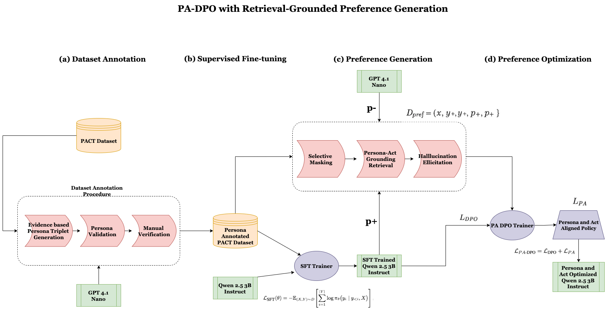

# 🧭 Mediator: Persona- and Act-Guided Direct Preference Optimization (PA-DPO)

[](https://www.python.org/downloads/)
[](https://pytorch.org/)
[](https://huggingface.co/docs/transformers)
[](LICENSE)

Official implementation of **PA-DPO (Persona-Act Direct Preference Optimization)** — a framework for persona-grounded, dialogue-act-consistent conversational agents in negotiation settings.

---

## 📌 Table of Contents
- [Overview & Architecture](#-overview--architecture)
- [Methodology](#-methodology)
- [Repository Structure](#-repository-structure)
- [Installation & Environment Setup](#-installation--environment-setup)
- [Dataset Schema](#-dataset-schema)
- [Pipeline Execution](#-pipeline-execution)
  - [1. Data Preprocessing](#step-1-data-preprocessing)
  - [2. Supervised Fine-Tuning (SFT)](#step-2-supervised-fine-tuning-sft)
  - [3. Preference Dataset Generation](#step-3-preference-dataset-generation)
  - [4. PA-DPO Alignment](#step-4-pa-dpo-training)
  - [5. Inference](#step-5-inference)
  - [6. Evaluation](#step-6-evaluation)
- [Baselines](#-baselines)
- [Citation](#-citation)

---

## 🔍 Overview & Architecture

Standard Direct Preference Optimization (DPO) aligns models on general fluency and helpfulness but frequently leads to persona drift, hallucinations, and strategic inconsistencies during multi-turn negotiations. **PA-DPO** addresses this by jointly learning persona extraction, act selection, and response generation under direct preference constraints.

<p align="center">
  
</p>

Given dialogue history $H = (A_1, U_1, \dots, A_{t-1}, U_{t-1})$ and current user turn $U_t$:
1. **Persona Triplets**: Extracts or tracks traveler preferences $(p_1, \dots, p_k)$.
2. **Dialogue Act**: Determines the agent's target act $a_t$ (e.g., *Propose*, *Counter*, *Clarify*).
3. **Agent Response**: Synthesizes the grounded utterance $A_t$.

### Formulation
* **Input Sequence**:
  $$X = \text{INST} \oplus H \oplus U_t$$
* **Target Output Sequence**:
  $$Y = \text{[BOS][BPER]}p_1 \dots p_k\text{[EPER][BACT]}a_t\text{[EACT][BRES]}A_t\text{[ERES][EOS]}$$

---

## 🧠 Methodology

```
                          ┌──────────────────────────┐
                          │  Raw Dialogue History    │
                          └────────────┬─────────────┘
                                       │
                                       ▼
                   ┌───────────────────────────────────────┐
                   │  Supervised Fine-Tuning (Qwen2.5-3B)  │
                   └───────────────────┬───────────────────┘
                                       │ Base Model (π_SFT)
                                       ▼
    ┌─────────────────────────────────────────────────────────────────────┐
    │                     Preference Data Mining                          │
    │  • Persona-Act Retrieval  • Selective Masking  • Hallucination Mining│
    └──────────────────────────────────┬──────────────────────────────────┘
                                       │ Pairs: (y⁺, y⁻), (pa⁺, pa⁻)
                                       ▼
                   ┌───────────────────────────────────────┐
                   │          PA-DPO Optimization          │
                   │      L_PADPO = L_DPO + λ · L_PA       │
                   └───────────────────────────────────────┘
```

1. **Supervised Fine-Tuning (SFT)**:  
   Initializes the base policy $\pi_{\text{SFT}}$ on paired conversational contexts using **Qwen2.5-3B-Instruct**:
   $$\mathcal{L}_{\text{SFT}} = -\mathbb{E}_{(X,Y) \sim \mathcal{D}} \left[ \sum_i \log \pi_\theta(y_i \mid y_{<i}, X) \right]$$

2. **Preference Construction**:
   * **Persona-Act Retrieval**: Gathers semantically aligned dialogue states to establish positive act/persona candidates.
   * **Selective Masking**: Corrupts valid turns by stripping key persona bindings to generate hard negatives.
   * **Hallucination Elicitation**: Generates negative turns where agent statements contradict known persona constraints.

3. **PA-DPO Objective**:
   Optimizes preference margin over complete turns while penalizing persona and act inconsistencies:
   $$\mathcal{L}_{\text{PA-DPO}} = \mathcal{L}_{\text{DPO}} + \mathcal{L}_{\text{PA}}$$

---

## 📂 Repository Structure

```text
mediator/
├── baselines/                  # Comparative baseline models
│   ├── final_dpo.py            # Standard DPO without persona-act guidance
│   ├── final_kto.py            # Kahneman-Tversky Optimization (KTO)
│   ├── final_ppo.py            # PPO reinforcement learning baseline
│   └── final_sft_llama.py      # LLaMA-based SFT pipeline
│
├── eval/                       # Benchmark evaluation scripts
│   ├── eval_padpo.py           # Core evaluation runner for PA-DPO
│   ├── eval_ppo.py             # Evaluation runner for PPO models
│   ├── final_eval_1.py         # Response generation quality metrics
│   ├── final_eval_2.py         # Negotiation & task-completion metrics
│   ├── pacons_classifier.py    # Persona-act consistency classifier
│   └── pacons_pre.py           # Preprocessing for consistency evaluator
│
├── inference/                  # Test inference & generation scripts
│   ├── final_infer_pa_dpo.py   # PA-DPO inference with structured parsing
│   ├── final_infer_sft_qwen.py # Direct inference for SFT Qwen model
│   ├── final_infer_ppo.py      # Direct inference for PPO model
│   ├── final_infer_gpt5.py     # External LLM judge & evaluation script
│   ├── final_infer_cpu.py      # Local CPU-only test runner
│   └── final_infer.py          # Unified entry-point for evaluation inference
│
├── PA-DPO/                     # Core alignment framework
│   └── final_padpo.py          # Main PA-DPO trainer implementation
│
├── preference_data/            # Dataset construction
│   ├── final_gen_triplets.py   # Triplet extraction script
│   └── final_pref_dataset_gen.py # Preference pair generator
│
├── sft/                        # Supervised instruction tuning
│   ├── final_preprocess_sft.py # Raw dialogue to instruction-token format
│   └── final_sft_qwen25.py     # Qwen2.5-3B instruction fine-tuning
│
├── PA-DPO_with_Retrieval.drawio.png # Architecture and dataflow diagram
└── README.md
```

---

## ⚙️ Installation & Environment Setup

### 1. Conda Environment
```bash
conda create -n mediator python=3.12 -y
conda activate mediator
```

### 2. Dependencies
Install PyTorch for your CUDA version (CUDA 12.1+ recommended):
```bash
pip install torch torchvision torchaudio --index-url https://download.pytorch.org/whl/cu121
pip install transformers datasets accelerate peft
pip install pandas numpy tqdm scikit-learn sentence-transformers
```

*(Optional) Multi-GPU distributed training support:*
```bash
pip install deepspeed
```

### 3. API Keys
For evaluation and triplet generation scripts relying on external LLM services, set your OpenAI API key in your shell environment:
```bash
export OPENAI_API_KEY="your-api-key-here"
```

---

## 📊 Dataset Schema

Input datasets must be structured in CSV format with alternating `traveler` and `agent` turns. Initial rows for each `dialogue_id` provide persona evidence:

| dialogue_id | turn | speaker | utterance | persona_evidences | persona_triplets |
| :---: | :---: | :---: | :--- | :--- | :--- |
| `1` | 1 | traveler | I’m planning a trip to Paris next month. | adventurous, budget-conscious | `(traveler, likes, adventure), (traveler, budget, low)` |
| `1` | 2 | agent | Great! Let’s find something exciting yet affordable. | — | — |
| `1` | 3 | traveler | I prefer boutique hostels or shared lofts. | prefers hostels | `(traveler, lodging, hostel)` |

---

## 🚀 Pipeline Execution

### Step 1: Data Preprocessing
Convert raw conversational logs into prompt-response training representations:
```bash
python sft/final_preprocess_sft.py \
    --input_path data/dialogues.csv \
    --output_path data/sft_ready.json
```

### Step 2: Supervised Fine-Tuning (SFT)
Fine-tune **Qwen2.5-3B-Instruct** on structured sequences:
```bash
python sft/final_sft_qwen25.py \
    --train_file data/sft_ready.json \
    --model_name Qwen/Qwen2.5-3B-Instruct \
    --output_dir outputs/sft_qwen25
```

### Step 3: Preference Dataset Generation
Construct preference pairs with persona and act signals:
```bash
# 1. Generate preference pairs
python preference_data/final_pref_dataset_gen.py \
    --input data/sft_ready.json \
    --output data/pref_data.json

# 2. Extract persona triplets
python preference_data/final_gen_triplets.py
```

### Step 4: PA-DPO Training
Train the final aligned policy using the composite objective:
```bash
python PA-DPO/final_padpo.py \
    --model_path outputs/sft_qwen25 \
    --pref_data data/pref_data.json \
    --output_dir outputs/pa_dpo
```

### Step 5: Inference
Run batch generation over evaluation splits:
```bash
python inference/final_infer_pa_dpo.py \
    --model_dir outputs/pa_dpo \
    --test_file data/test.csv \
    --save_path results/padpo_generations.json
```

*For unformatted generation strings without token parsing:*
```bash
python inference/final_infer_pa_dpo.py --raw_output
```

### Step 6: Evaluation
Compute objective metrics for persona fidelity, act agreement, and conversational quality:
```bash
python eval/eval_padpo.py \
    --pred_file results/padpo_generations.json \
    --ref_file data/test.csv
```

---

## 📈 Baselines

| Method | Script | Description |
| :--- | :--- | :--- |
| **SFT (LLaMA)** | `baselines/final_sft_llama.py` | LLaMA baseline fine-tuned without persona-act guidance |
| **Vanilla DPO** | `baselines/final_dpo.py` | Standard DPO objective without structural tags |
| **KTO** | `baselines/final_kto.py` | Kahneman-Tversky Optimization baseline |
| **PPO** | `baselines/final_ppo.py` | RL baseline optimized against a reward model |
| **PA-DPO (Ours)**| `PA-DPO/final_padpo.py` | Full joint persona-act direct preference optimization |

---

## 💬 Citation


---

## 📄 License
This codebase is released for academic research and educational evaluation purposes.
